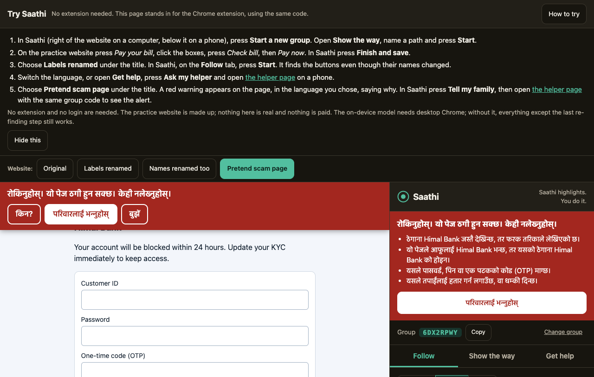

# Saathi

**Someone who has done it shows the way once. Everyone with the group code gets a patient guide that highlights each button, in their own language. Saathi highlights. You do it.**

Saathi is a Chrome extension for **older adults and the family who look after them**, often from far away. Bill, bank and government websites are where an older person gets stuck and where scammers go after them. A son, a daughter or an experienced friend records a task once. After that, the older person sees one step at a time, with the right button outlined on their own screen, in English, Nepali or Hindi, with large text and read-aloud. They can speak what they need instead of searching a list. If a website changes, the guide finds the button again. If they are still stuck, a family member on a phone taps the right button from afar and it lights up on their screen.

It never clicks, types or submits for anyone. It also watches for scam pages: when the page in front of an older person looks like a bank or wallet page that is not the real one, a red warning appears on the page, in their language, and they can tell their family with one tap.

Built for the #BuildHybridAI hackathon with Firebase AI Logic. Licence: MIT.

## For older adults and their caregivers

Saathi was built for the *AI for the aging population* theme: voice interfaces, monitoring and caregiver coordination software built for older adults. Here is how it fits, and where it does not.

| Theme | What Saathi has | What it is not |
|---|---|---|
| **Voice interface** | **Speak**: say a request in Nepali, Hindi or English and Saathi starts the right guide. Read-aloud for each step. | Not a hands-free assistant. Real Nepali speech has not been tested (see below). |
| **Monitoring** | A scam guard that watches the page in front of the person and warns on the page, in their language, and a checker for suspicious texts and WhatsApp messages pasted into the panel. It is a safety watch on the web page, with no cameras, sensors or location. | Not health, fall or location monitoring. |
| **Caregiver coordination** | A group shared by a family. Guides recorded once, shared with everyone. A live "I'm stuck" request that a family member answers from a phone. Scam alerts that reach the family. A "Let my family know I finished" button on the finished card, which shows the family only the guide's name and step count. | Not a care-planning or medication tool. |
| **Built for older adults** | One step at a time, large text, a clear next button, and no automatic clicking or typing: Saathi highlights and the person does it. Warnings and steps in their own language. | It has not been tried with older people yet. |
| **Home robotics** | Not covered. | |

The older person's data stays with them by design: the page they are on is read on their laptop, and what a family member sees is only the names of buttons, a website's address, or a short alert (see "What is saved and what is sent").


## Try it in two minutes, no install

**https://paperwork-decoder.web.app/try.html**

The practice website (a made-up electricity board) is on the left and the real Saathi panel is on the right. A tour across the top walks through six steps in plain words, and each step has one button that does it for you, so nobody has to read a manual or record anything first: **Get the guide** (a ready-made guide a family member "made"), **Start the guide** (Saathi points at each button), **Change the website** (the buttons are renamed and Saathi still finds them, or says it is not sure), **Show a fake bank page** (the scam warning), **Try an example message** (the message checker), and a last card that links to the family page. The page stands in for the Chrome extension and runs the extension's own page script, so you are trying the same code. [tools/e2e-tour.mjs](tools/e2e-tour.mjs) walks the tour on the live page (9 of 9 checks).

Everything else is still there if you want to go further:

1. Open **Make a guide**, name it, press **Start**, do the task on the website once (*Pay your bill*, the two boxes, *Check bill*, *Pay now*), and press **Finish and save**. Press **Invite** to send the family code and a helper link to someone.
2. Press **Speak** and say, in Nepali, Hindi or English, what you need, for example "I need to pay the electricity bill". It asks for the microphone; the recording goes to the cloud only when you press Speak.
3. Switch the language to नेपाली or हिन्दी. Turn on large text or read-aloud.
4. Open **Get help**, press **Ask my helper**, then open [/help.html](https://paperwork-decoder.web.app/help.html) on a phone, enter the family code and tap a control. Or pick **A fake bank page**, press **Tell my family**, and see the alert on the helper page.
5. Under **Practice: spot the scam**, press **Start practice** and answer six made-up messages. Saathi shows its own verdict and the reasons after each one.

No login is needed. Nothing is paid and nothing on the practice website is real. It works on a phone too: the website sits above Saathi, so both are on screen at once (see below).

**On-device model:** it runs only in desktop Chrome with the built-in Gemini Nano model. Without it, everything still works except the last re-finding step (a button whose label *and* internal name both changed). The panel's header shows whether the model is available.

## Where each part runs

| Task | Runs | Why |
|---|---|---|
| Finding a recorded step again on the live page | On-device only | The page may be a bank or government page. It is read on the laptop and never sent anywhere. |
| Explaining what a page wants | On-device first, cloud fallback | The fallback sends only the page title and up to 60 button and box names. Never anything typed. |
| Translating a path's step sentences into Nepali and Hindi | Cloud only, once, when the path is saved | The on-device model writes only English, Spanish and Japanese. The cloud sees the path name and the step sentences, nothing else. |
| Understanding a spoken request (Nepali, Hindi or English) | Cloud only, when the person presses Speak | The on-device model does not understand Nepali speech. The cloud hears the recording and sees the titles of the group's paths, nothing from the website. |
| Finding a step when the on-device model is unsure, or there is none | Cloud, only if the person presses a button after seeing what would be sent | The cloud sees the old label and the names of up to 60 buttons and links near the step. A label with a personal detail is replaced first. Nothing typed. |
| Checking whether the page in front of the person is a scam | On-device, plain code, no model | The page's words and its boxes are read on the laptop and never sent. A small model is poor at this kind of judgement, so none is used. |
| Helper taps a control on a phone | No model | The helper sees only the names of the controls, written to Firestore. |

Every model call goes through one file, [src/firebase.js](src/firebase.js), using Firebase AI Logic's hybrid modes. No other AI service is used. The cloud model is named explicitly (`gemini-3.5-flash-lite`).

**Why hybrid and not cloud only.** A cloud-only version would work, but it would have to upload the labels of the live page, which can be a bank or government page, at every step. Saathi keeps that on the laptop and uses the cloud only for what the small model cannot do (writing Nepali and Hindi) and only on the path's own written steps. This is a privacy argument. It is not a claim that the cloud is impossible.

### Verify the hybrid split yourself

**Where the AI ran.** Under *Technical details* in the panel, *Where the AI ran this session* lists every model call: what was asked for (on-device, cloud, prefer on-device), where it actually ran, how long it took and how many characters were sent (nothing for an on-device call). It never keeps the prompt or the answer. It exists so the hybrid split can be checked on screen instead of taken on trust.


1. Open the try page in desktop Chrome and expand **Developer checks** in the panel.
2. Press **Run on this laptop**. The result says *Ran: on this laptop*.
3. Press **Run in the cloud**. The result says *Ran: in the cloud*.
4. Record and save a path, then follow it on **Labels renamed**. Under the step card, the line says how each step was found: *by its label*, *by the link or box underneath*, or *by the on-device model*.
5. Press **Explain this page**. The result says *On this laptop. Nothing left it.* or, if the model is unavailable, *In the cloud. Sent: the page title and N labels, 0 typed values.*

## Platforms

One codebase, one Firebase project and one set of security rules serve every device below. What differs is which part of Firebase AI Logic's hybrid inference is available, and the app picks at run time instead of being built twice.

| Device | How it runs | What works | Where the AI runs |
|---|---|---|---|
| Computer, Chrome | Chrome extension (side panel) | Everything: record a guide on any site, follow it with highlights, scam warning on pages, family alerts | On-device Gemini Nano when installed (short tasks send nothing), cloud model otherwise |
| Android phone or tablet | **Android app** ([android/](android/), a Capacitor shell around the same site, loaded from the hosted address) | The helper page (answer "I'm stuck", scam alerts, check-ins), pasted-message check, practice quiz, "Ask about this step", the practice site, speech input | Cloud only: Android WebViews have no on-device model, so the same call falls back to the cloud model |
| iPhone, iPad | Installable web app (PWA), no native app | The same as Android | Cloud only |
| Any other browser | The site, no install | The practice site and the helper page | Whatever the device offers |

The home page ([index.html](index.html)) shows which row the device is, whether the on-device model is ready, and an **Install** button (on iPhone and iPad it explains "Share, Add to Home Screen"). The installed app opens with no internet: [public/sw.js](public/sw.js) keeps the site's own pages and built files, and never keeps Firebase or AI calls; saved guides come from Firestore's on-device cache.

**What I checked:** [tools/e2e-pwa.mjs](tools/e2e-pwa.mjs) on the live site in headless Chrome: a valid manifest with 192, 512 and maskable icons, a service worker that takes control, and the helper page and home page opening with the network switched off (8 of 8). The try-page flow also runs at phone size and with touch (12 of 12).

**The Android app, tested on an emulator.** I installed the Android SDK with Homebrew, built a debug APK (`npm run android:build`, output `android/app/build/outputs/apk/debug/app-debug.apk`) and ran it on an Android 14 emulator (Pixel 6, arm64). I drove its WebView over Chrome DevTools ([tools/android-cdp.mjs](tools/android-cdp.mjs), [tools/android-ask.mjs](tools/android-ask.mjs)). On that emulator: the home page identifies the device as the Saathi Android app; Firebase sign-in, App Check and a cloud model call all work (a plain "ready" answer in about 7 seconds); and the full flow works inside the app: record a one-step guide on the practice site, save it (translated), follow it, and ask about the step in English, Nepali and Hindi, with real model answers shown with "Answered in the cloud" and the AI use log listing all five calls as cloud calls.

**What running on Android found and fixed.** The emulator's WebView is Chrome 113, which lacks `AbortSignal.any`; the Firebase AI SDK uses it, so every model call failed with "AbortSignal.any is not a function". A small polyfill ([src/polyfills.js](src/polyfills.js), 3 unit tests) fixes it, and many older phones keep an old WebView, so this matters for the audience. The first real answers in Nepali and Hindi also described "blue" words that the model cannot see, against the prompt's own rule, so answers now drop any sentence that names a colour or a position (8 unit tests). One Hindi answer was cut to a single sentence by this filter.

**Not tested, and not claimed:** a real Android phone (an emulator only), any other Android version, the on-device model on Android (this app uses the cloud only), Google Play (the APK is a debug build and is not signed for release), and iOS: full Xcode is not installed here and cannot be installed with Homebrew, so there is no iOS app, only the web app. The app is a shell around the hosted site, so it needs an internet connection the first time; after that the page and its saved guides open offline in the same way the web app does.

**What I did not do:** a native iOS app, an app written natively in Kotlin or Flutter (the Android app is a shell around the same web code), a real-phone test, or following a guide on *other* websites from a phone: phone browsers and WebViews cannot add a guide to another site, so that part needs the Chrome extension on a computer.

## Firebase products used

| Product | Use |
|---|---|
| **AI Logic** | Every model call, on-device and cloud, in hybrid modes |
| **App Check** | Enforced. The hosted panel uses reCAPTCHA Enterprise. A local debug token exists only in development builds and is compiled out of the release build. |
| **Authentication** | Anonymous sign-in, so there are no names or passwords |
| **Firestore** | Shared paths and live help requests, with [security rules](firestore.rules) and an on-laptop cache |
| **Remote Config** | `cloud_enabled` (off-switch for every cloud call), `max_labels`, `languages` |
| **Hosting** | The panel, helper page, try page and practice website |

Toggle `cloud_enabled` to false in the Firebase console and the panel's cloud chip changes to *Cloud: switched off* on the next load. Translation is skipped and *Explain this page* stays on-device.

## What is saved and what is sent

| | Page addresses | Button and box names | What you typed | Pictures of the page |
|---|---|---|---|---|
| **Saved in a path** (Firestore) | Path only, no part after `?` or `#`. A part that holds a number, an `@`, a user name or a long token is replaced by `~`. | Yes, in order. A label with a name, an email, a number (including Devanagari digits), a card ending (`**** 1234`) or a greeting (`Hello, Ram Sharma`) is dropped, as is any name-only label in the page header's account corner. | Never | Never |
| **Sent to the cloud for translation** | No | The path name and the English step sentences | Never | Never |
| **Sent to a helper's phone** | No | Names only, and the person sees exactly what will be sent before pressing Send | Never | Never |
| **Sent to the cloud when you press Speak** | No | Only the titles of your group's paths, which the group wrote | Never | Never. A short voice recording is sent, once, and not stored. |
| **Sent to the cloud when Saathi speaks in Nepali or Hindi (Natural voice)** | No | One short sentence: a step, a warning or an answer, with personal details replaced, and cut to 400 characters. Switch off with the Natural voice button. | Never | Never |
| **Sent to the cloud when you ask about a step** | No | The step, the guide's name and your question, with personal details in it replaced | Never | Never |
| **Sent to the cloud when you agree to "Ask the cloud to look"** | No | The old label and up to 60 button and link names near the step, with personal ones replaced. The panel lists examples first. | Never | Never |
| **Sent to the family when you press "Tell my family"** | The website's address only, no path | The imitated brand's name and reason codes such as "asksSecret" | Never | Never, and none of the page's words |
| **Sent anywhere when re-finding on this computer** | No | No. It stays on the laptop. | Never | Never |

The page script reads a field's label, never its value. A path step has no field that could hold a typed value ([src/path.js](src/path.js)), so one cannot be saved by mistake. A step also stores a small number, its position among the page's controls, to help find it again on a long page. Help requests are deleted when the person stops sharing.

## Scam guard



When the person opens a page that looks like a scam, Saathi puts a red bar on the page itself, in the language they chose, with a "Why?" button that lists the reasons in plain words. The panel shows the same warning. The person can press **Tell my family**: that writes an alert to the group, and the family sees it on the helper page, and in their own panel if it is open.

**How it decides** ([src/guard.js](src/guard.js)). Plain code on the computer, no model. It adds up facts a person cannot easily see, and says "stop" only when several agree (a score of 5 or more; 3 or 4 is a gentler "be careful"):

- The address looks like a bank's but is not (a typo, or the bank's name hidden inside a longer address): 3 points.
- The page's title or heading names a listed bank, wallet or government site, but the address is not one of that site's real addresses: 2 points.
- The page asks for a password, PIN or one-time code: 1 point, and 3 more when the page is also pretending to be a listed site. This is judged from what each box is, never from what is typed.
- It pushes you to hurry or threatens you, in English, Nepali or Hindi: 1 or 2 points.
- It asks you to install a remote-control app, or to pay by gift card or crypto: 3 or 2 points.
- The connection is not secure and it asks for a secret, or what you type would be sent to a different website: 2 or 3 points.

It knows 22 real banks, wallets, utility and government sites in Nepal, India and Bangladesh ([the list](src/guard.js)), and one made-up bank for the practice page. Global brands such as Google and Amazon are left out on purpose: their real addresses are too many to list completely, and a wrong guess would block a real site. The warning sentences are written by hand in three languages ([src/guardText.js](src/guardText.js)), so a warning never waits for a model or the network. They have not been reviewed by a native speaker.

**What it is not.** It is not a replacement for the browser's own protection: Chrome has built-in on-device scam detection. Saathi adds three things: the family loop, the South Asian institutions that scammers copy, and warnings in Nepali and Hindi. It warns and does not block. It catches only scams that imitate a listed site or use the signals above.

**What was measured.**

| Test | Result |
|---|---|
| 12 made-up scam pages ([test/guard.fixtures.js](test/guard.fixtures.js)) | All 11 marked "stop" are stopped; the 12th (a prize page asking for a fee, with no box to type in) gets "be careful", as intended |
| 14 made-up ordinary pages, including a real bank login on its real address, a Wikipedia article about a bank, the remote-support tool's own site and a shop checkout with card boxes | None stopped; 2 get a gentle "be careful": a news story about phishing, and an old school portal still on plain http |
| 13 real, legitimate pages, visited live with the real extension (Wikipedia, python.org, the Nepal Electricity Authority, the passport office, the Bangladesh portal, the real Nabil Bank, eSewa, Khalti and tax-department sites, and GitHub, Google and PayPal sign-in pages) | No warning on any of the 13 |
| The family loop on the try page ([tools/e2e-guard.mjs](tools/e2e-guard.mjs)): the pretend scam page, the warning on the page in Nepali, the panel, "Tell my family", the helper page | 9 of 9 checks pass. The alert holds no page content. |

The made-up pages were written by me, so they show that the rules do what I intended, not how many real scams they would catch. No real scam page was visited, on purpose. A false-alarm rate on a large sample of real pages is not known: 13 real pages is a small sample.

**Limits.** A clever scam can score below "stop". The on-page family button only works while the side panel is open (the page tells the person how to open it). The extension's own relay of the family alert was not exercised in a real scam situation, only through the try page's stand-in. The pretend scam page claims a made-up address, as a real scam would, which is how the try page can show it without hosting a fake bank page.

### Checking a pasted message

Scams also arrive as texts and WhatsApp messages, so the panel has a **Got a strange message?** box. The person pastes the message and presses **Check a message** ([src/messageCheck.js](src/messageCheck.js)). It uses the same plain-code approach as the page guard, on the computer, with no model, and the message is never sent anywhere. It looks for: a link whose address imitates a listed bank (or names a bank while the link goes elsewhere), a shortened link, a request to read out or send a code, PIN or password (a sentence that tells you *not* to share one, as real banks do, is not counted), a rush, an app to install, and "this is my new number, send money". The warning comes in English, Nepali or Hindi. "Tell my family" sends only the link's address (if any), the brand and reason codes, never the message.

| Test | Result |
|---|---|
| 12 made-up scam messages ([test/message.fixtures.js](test/message.fixtures.js)): fake KYC, lottery, parcel fee, "my new number", OTP request, APK, remote support, in English, Nepali and Hindi | All 12 get a warning: 8 "stop" and 4 "be careful" |
| 9 scam messages written to follow what banks, the Nepal Police Cyber Bureau, CERT-In and the RBI have published ([test/message.published.js](test/message.published.js)) | **Before I tuned the rules, 4 of 9 got a warning and 5 got none** (a connectIPS "self-verify" text, a Dashain prize with a "service charge", a KYC text with a throwaway tunnel link, among them). After adding what those showed (connectIPS and the RBI as known names, KYC-by-link, throwaway addresses, more rush wording) all 9 are stopped. That second number is not independent evidence, because the rules were tuned on these 9 |
| 28 made-up ordinary messages, 16 of them chosen to use scam words for ordinary reasons (a real "KYC updated" notice, "your NTC pack will expire", a family "my new number", a real bank OTP text that says to enter the code on the website) | None warned |
| An independent read of the code by a second model, with each trigger run ([how it was done below](#independent-review)) | 12 findings, all fixed and each now covered by a test |
| The try page ([tools/e2e-try.mjs](tools/e2e-try.mjs)): paste the scam text, see the warning, press "Tell my family" twice quickly, read what was written | Passes. One alert is written, holding only the kind, the link's address, the brand, the level and the reasons |

The messages were written by me or follow published reports, so this shows the rules do what I intended, not how many real scams they catch. The honest signal is the 4 of 9: rules written by the person who wrote the test messages looked perfect, and rules met with someone else's examples were not. A friend asking for the wifi, router or streaming password no longer gets a warning, unless a bank word, OTP or PIN is anywhere in the message (a trick like "your bank wifi password" still warns). Other false alarms of that kind are likely. For messages, 2 points is "be careful" and 5 is "stop". "Nothing suspicious found" is worded as *not proof of safety*. No real scam message from a real person's phone was used.

### "Where is…?" while following a guide

During a guide, a box under the step asks "Where is…?". The person types a name ("sign out", "where is the pay button") and Saathi outlines that control on the page with a green dashed line for ten seconds, without touching the step's own outline or moving the guide on. If several controls fit (three "Edit" buttons) it lists them and lets the person choose; it never guesses. It is plain code on the person's computer: the words and the page's control names are not sent anywhere. [tools/e2e-where.mjs](tools/e2e-where.mjs) runs it on the live try page: the other control is outlined, the step outline stays, nothing is pressed, and an unknown name gets "could not find" instead of a guess. It matches the words on the page, so "pay" will not find a button that says "Make a payment" unless those words are in it; there is no synonym search.

### "Ask about this step" while following a guide

A second box asks a short question about the step in front of the person ("what does this mean?"). The model is sent only the step's wording, the guide's name and the question, with personal details in the question masked first, and the privacy line is shown under the box. **Where it runs depends on the language, and the screen says where it ran.** Chrome's on-device model writes only English, Spanish and Japanese, so an English question uses the on-device model when it is installed and falls back to the cloud model otherwise (hybrid inference), while a Nepali or Hindi answer always needs the cloud and is refused with a plain message when the cloud is switched off. The prompt tells the model it cannot see the screen, must not describe the page, must never tell the person to type a password, PIN or code, and must say "ask your family" for money, codes or anything unsafe. **Checked:** the choice of model, the masking, the prompt and the answer cleanup by 11 unit tests; the box and its failure path on the live try page (an automated browser is refused by App Check, so it shows "Could not answer. Ask your family." and the button works again). **Not checked:** a real answer from either model, in any language. The first thing to try is asking on the try page in your own Chrome.

### The voice

Read-aloud can speak from two places, and the screen says which. **The voice on the device** is free and sends nothing; most devices have an English voice, some a Hindi one, few a Nepali one. **The Saathi voice** is Firebase AI Logic's text-to-speech (a Gemini model, `gemini-3.1-flash-tts-preview`, changeable from Remote Config as `tts_model`): it speaks Nepali, Hindi and English, and sends only the one short sentence to be spoken, with personal details masked first. The rule ([src/tts.js](src/tts.js), 15 unit tests): English uses the device voice when there is one, so the cloud is not spent where it is not needed; Nepali and Hindi use the Saathi voice when the cloud is on and **Natural voice** is switched on; if the Saathi voice fails or says its daily limit is used up, the device voice is used, and then the text. A repeated sentence is not fetched twice. Calls show in *Where the AI ran* as "text to speech".

**Checked on an Android 14 emulator:** all three languages came back as audio (24 kHz speech, raw PCM that Saathi wraps into a WAV so a browser can play it) in about 5 seconds each, played without an error, and the limit path shows the right note and stops asking. **Not checked:** how any of it sounds, because I cannot hear audio here; whether the Nepali is pronounced well; whether the slow-and-kind instruction in front of the sentence is spoken aloud (it made the audio about twice as long, which looks like slower delivery, not extra words, but I could not listen).

### Practice: spot the scam

Under the message checker, **Practice: spot the scam** gives the person a round of six made-up messages, half scams and half ordinary ([src/quiz.js](src/quiz.js)). They answer "Scam" or "Looks fine", then Saathi shows its own verdict and, for a scam, the reasons in plain words. The score appears at the end. It is in English, Nepali and Hindi, nothing is saved or sent, and it is spoken aloud when read-aloud is on. The unit tests check that every card agrees with the message checker, so Saathi never marks a card "scam" that it would not itself warn about. Read-aloud also reads the scam guard's and the message checker's warnings, and the message result has a **Read it to me** button.

Not measured: whether practice helps anyone spot a real scam. It is a first draft of the idea and has not been tried with older people.

### Independent review

Before the final push, a second model read the code added in the last stretch (check-ins, message checker, practice quiz, read-aloud) with instructions to find real bugs, run each one, and say which it had run and which it had only read. It reported 12. They were fixed, and each has a test or an end-to-end check:

- A link written `http://nabilbank.com@evil.top` was read as going to the real bank (the real destination is after the `@`).
- Links ending in `.cfd`, `.sbs`, `.ru`, a number address or non-English letters were not seen at all.
- "Do not delay: share your OTP" was treated as a warning not to share, because any "do not" in the sentence cancelled the request. A real warning ("do not share your OTP") still passes.
- Real bank texts that say "enter this OTP on the website" were flagged as requests for the code.
- A missing space after a full stop ("Thanks.Me too") was read as a link.
- A family message naming a bank next to a Google Photos link was flagged.
- Pressing "Tell my family" twice sent two alerts, and the confirmation vanished on a language switch.
- Joining a group after a result left the "Tell my family" and "I finished" buttons disabled.
- Switching language mid-quiz left the answer in the old language.
- A 2,000-character box limit silently cut long messages that the checker was meant to read up to 4,000 characters of.
- Screen-reader and focus gaps on the new controls, and a dark-mode button colour below the accessibility contrast minimum on the helper page.

This is a code review by a model, not a test with people. It did not run a screen reader.

### Second review: the older core

A second model then read the older code (the scam guard, how a step is found again, the privacy masking, the extension's messaging, the database rules) with the same instructions: run each suspected bug, say what it ran. It reported 12 more, and a few lower-priority ones. What was fixed:

- **Privacy.** Names after a greeting (`Hello, Ram Sharma`, `नमस्ते, राम शर्मा`), Devanagari digits, card endings, user names and header account-corner labels were not recognised as personal, so they were saved in a path and sent to the cloud. The page title, headings and path parts (`/u/ram.sharma/reset/abc123tok`) were stored or sent unmasked, in a saved path, a help request, "Explain this page" and the cloud re-find. All now go through the same masking, with tests.
- **Pointing at the wrong control.** A label one character away ("Pay Rs 500" and "Pay Rs 5000", "Turn on" and "Turn off", "Sita" and "Gita") counted as the same control. The guide now accepts a label only if it is the same apart from capitals and punctuation, and otherwise tries the link address, then the model. Three rows that each say "Edit" were collapsed, so the guide pointed at the first one; it now declines. A step saved without its label is no longer put to a model. A generic internal name such as `submit` is no longer trusted as an anchor. A highlight is now tied to the exact page reading it came from, so a pick made on one tab cannot light up a control on another.
- **The scam guard.** Look-alike letters (a Cyrillic `а` in `nabilbank.com`, which Chrome writes as `xn--nbilbank-16g.com`) were never caught. Short names (eSewa, Paytm, NMB, UIDAI) hidden in a longer address (`esewa.com.np.verify.top`) were not caught. The list of public endings was too small. False alarms: a checkout posting to a payment provider, a newsletter box on a login page, "PIN code" as a secret, a router login on `192.168.x.x`, a news article about a bank scam. The page is now looked at again when it changes, not just in its first two minutes. The warning bar is in a shadow root, ignores clicks made by a script on the page, and one alert per website per minute is accepted.
- **The extension.** Only one tab records (a click in another tab was becoming a step), and a background tab can no longer clear the warning for the one you are looking at. Controls that are greyed out, switched off, off to the side, or specks of a few pixels are no longer offered. Slides in a rotating banner are left out, because one is gone a moment after it is read.
- **The database rules.** A path's translations must be Nepali and Hindi only, one line per step. Help requests last at most 3 hours, can only be answered while open and not expired. Alerts and check-ins last at most 3 days. Paths read back from the database are rebuilt field by field before use, because anyone who knows a group code can write to that group.

Found by running the fixes against real sites (the real-website test passes again after each: all four click-throughs finish, and of 12 redesign checks 6 are right, 6 decline and 0 are wrong): my own first version of the "off-screen and hidden" check treated anything under `aria-hidden` as invisible, which stopped recording on the Nepal passport office site (it marks things people can see with `aria-hidden`). That was caught only because the real-site test failed, and the check was loosened. A second: on the Bangladesh national portal the guide pointed at a link inside a rotating banner that was hidden a moment later, so banner slides are now left out. A third: my first user-name rule for paths turned Wikipedia's `/wiki/Main_Page` into `/wiki/~` and stopped the guide finding that link; the rule now applies only after a path part like `/u/` or `/user/`. A fourth: refusing to choose between controls with the same label also refused a logo and a menu entry that go to the same address, so those are now treated as one.

**Not fixed, and why.**
- The Firestore expiry policy that would delete old help requests and alerts automatically needs a paid Firebase plan (the project is on the free one). Old requests are ignored by the apps and can no longer be answered. Each person's panel now deletes that person's own expired help requests, alerts and check-ins when it opens, so only records whose author never opens Saathi again stay until deleted by hand. A help request holds only control names, with personal ones removed.
- A name written alone, such as a profile button `Ram Sharma` outside the page header, cannot be told apart from a button like `Pay Bill` without a model. Only the account corner of a page header is treated that way.
- Controls inside iframes and *closed* shadow roots are not read; the guide declines for those (safe), and the scam guard sees no boxes inside a framed login form. Controls inside *open* shadow roots (web components) are read, and checked on a made-up web component only, not on a real site that uses them.
- A page can remove or hide the warning bar, but the guard checks every second and puts it back (checked: removed, then hidden with `display:none !important`; both came back). A page that fights this by removing it again and again would flicker. The panel shows the same warning.
- The rules cannot check each step in a path one by one (Firestore rules cannot loop), so the app rebuilds each one when it reads it.

This is a model reading code, not a pen test. It did not use a screen reader or a real attacker's page.

## What we measured

All numbers are from the real on-device model in desktop Chrome. Reproduce them with the test pages and scripts below.

**Finding a step again on the practice sites** ([refindeval.html](refindeval.html)): five made-up sites, 25 recorded steps, each site changed four ways, 80 cases. Two configurations, measured on the same cases:

| Change | Earlier setting: every control offered, looser check | Current setting: same section first, then every control, stricter check |
|---|---|---|
| Button moved, same label | 25 of 25 (plain code) | 25 of 25 (plain code) |
| Label renamed | 23 of 25 | 17 of 25 |
| Label renamed and button moved | 22 of 25 | 15 of 25 |
| Control removed (the right answer is "it's gone") | 4 of 5 | 5 of 5 |
| **Overall** | **74 or 75 of 80, one wrong pick** | **62 of 80, no wrong pick** |

The first prompt scored 63 of 80 with 17 wrong picks on the model cases. Asking in two orders, taking out controls that belong to other steps, and checking the pick with a yes/no question brought it to 74 or 75. Real pages then showed that the earlier setting was too eager (next section), so the current setting declines more often: it finds fewer steps on these easy sites and never points at a wrong control. A wrong pick is the harmful failure, because it sends a person to the wrong button, so the current setting is the default.

Caveats: the earlier improvements were designed after looking at failures on these same five sites. Each run takes a different path through the model, so results move by a case or two.

**The on-device model on real pages.** The practice sites have about 25 controls. Real pages have far more (Wikipedia 150, python.org 147), and the model did much worse on them. [src/realEval.js](src/realEval.js) replays what the extension actually read on four real public pages (saved by [tools/capture-scans.mjs](tools/capture-scans.mjs): Wikipedia, python.org, the Nepal Electricity Authority, the Bangladesh national portal). For each test case a control is renamed, with its link address and name removed so only the model can find it, or hidden. The model runs in Chrome through Firebase AI Logic's on-device mode, as in the product. 23 cases: 18 renamed controls and 5 removed ones.

| Setting | Renamed: right / declined / wrong | Removed: right / wrong |
|---|---|---|
| Every control offered, looser check (the earlier setting) | 5 / 10 / 3 | 5 / 0 |
| Same section first, looser check | 15 / 2 / 1 | 3 / 2 |
| Same section first, stricter check | 11 / 7 / 0 | 4 / 1 |
| Every control offered, stricter check | 5 / 13 / 0 | 5 / 0 |
| **Current: same section first, then every control, stricter check** | **9 / 8 / 1** | **4 / 1** |

- The big gain is from offering the model only the controls in the step's own part of the page (11 to 20 instead of up to 150).
- The stricter yes/no check ("the very same control, only renamed; related is not enough") is what removes wrong picks.
- The fallback to every control is there for controls that moved as well as being renamed, which the practice sites showed matter.
- Each setting was run once, and a repeat of the same setting moved by about two cases, so treat the differences as rough. The current setting was chosen after seeing these cases, so its figures are likely a little optimistic.
- The wrong picks that remain are near-synonyms: a removed "Socialize" matched to "Community", and, on the Bengali page, "all services" matched to an existing "all e-services" card.
- Bengali: the model does not read Bengali, yet it matched some Bengali labels. 3 renamed Bengali controls: 1 right, 1 declined, 1 wrong, so no claim is made for Bengali.
- A model step on a real page takes about 4 seconds, from 2 to 6 model calls.
- **Long pages.** The page script used to read only the first 150 controls, so a control further down, such as a footer link, was invisible. A long Wikipedia article has about 4,000 controls (2,389 after repeats are merged) and its footer links sit near the end, so the script now reads whole pages (up to 6,000 controls; checking 4,000 takes about 17 ms). The model is still never shown a long list: it sees the controls in the step's own section, and at most 60 of them, the ones nearest the step's recorded position on the page. On the long article, 3 of 4 renamed footer controls were found, 1 was declined, none was wrong, and the removed one was declined, each in about 1.5 seconds.
- After that change the whole replay was run again (the Wikipedia main page now reads 250 controls instead of 150, so the numbers above and these are on slightly different data, and the long-article cases were re-run separately): 22 renamed controls, 14 right, 7 declined, 1 wrong; 6 removed controls, 5 declined and 1 wrong.
- Not measured: Devanagari pages, pages that need a login, and full multi-step paths with the model.

**Asking the cloud when the on-device model is unsure.** When the guide cannot find a step, or the computer has no on-device model (a phone, or a laptop where it is not installed), the step card offers "Ask the cloud to look". It first shows what would be sent: the old label and the names of up to 60 buttons and links near the step, with a personal label replaced. Nothing is sent until the person presses the button. The same 28 real-page cases, asked of the cloud model:

| Cloud setting | Renamed: right / declined / wrong | Removed: right / wrong | Median time |
|---|---|---|---|
| Three calls: two orderings and a yes/no check | 18 / 3 / 1 | 5 / 1 | 15 s |
| Two calls: one ordering and the check | 19 / 3 / 0 | 5 / 1 | 15 s |
| **One call (used)** | **22 / 0 / 0** | 4 / 2 | **8 s** |

The strong cloud model needs none of the careful checks that the small on-device model does, and one call is half the time. The cost is that for a control that has been removed, it twice picked a near-synonym ("Socialize" matched to "Community") instead of saying it is not sure. Timings varied a lot between runs. For comparison, the on-device model found 14 of the same 22 renamed controls. What was not verified end to end: pressing the button in a normal Chrome and watching the cloud's answer get highlighted. In a headless browser the button appeared with the right text and sent nothing before the click, and App Check refused the cloud call for that automated browser; the cloud's finding itself was measured through the same code above.

**Speaking a request.** On the My guides tab, **Speak** records up to 8 seconds, sends the recording and the titles of the group's paths to the cloud model, and starts the path it picks. It exists because the on-device model does not understand Nepali speech, so this is a task where the cloud is genuinely needed. It shows what it heard, in the language spoken and in English, and it refuses when no path matches. Tested in a normal Chrome with a fake microphone playing speech made by the Mac's text-to-speech, against a group with one path ("Pay the electricity bill", with Nepali and Hindi titles):

| Spoken | Heard | Result |
|---|---|---|
| Hindi: "मुझे बिजली का बिल भरना है" | Exactly, with the English "I want to pay the electricity bill" | Matched, started following |
| English: "I want to pay the electricity bill" | Exactly | Matched, started following |
| English: "I want to renew my passport" | Exactly | Refused: "I could not match that to one of your guides" |

**Not tested:** real spoken Nepali (this Mac has no Nepali voice, so I could not make any); real human voices, accents and background noise; a group with many similar paths (matching against one path is easy); and the microphone permission prompt inside the extension's side panel, where browsers do not always show it. The extension has a small page, `mic.html`, that asks for the microphone once in a normal tab as a fallback; it was not verified. The first thing to try is saying a request in Nepali on the try page.

**Things we tried that did not help, and removed or did not adopt:**
- Structured (schema-constrained) output for the model's answers: 44 right against 49 for plain text on the 55 model cases, because the constrained model said "not sure" about twice as often. Plain text is used for re-finding. Structured output is used where an answer is a longer shape, for the cloud translation.
- Offering only same-kind controls first (buttons with buttons) on the practice sites: slightly better on renamed-and-moved steps, but 3 wrong picks against 1 when a control was removed, so it was reverted. Narrowing by section, tried later on real pages, is used (above).

**On real websites.** [tools/e2e-real.mjs](tools/e2e-real.mjs) records a short path on four live public pages, saves it, follows it by clicking through the real pages, and then checks it again after a script simulates a redesign. Nothing is typed or submitted; it only clicks ordinary links. The pages are the Bangladesh national portal (Bengali labels), the Nepal Department of Passports (Nepali labels, with a pop-up notice over the page), Wikipedia's main page and talk page (English), and a long Wikipedia article (about 4,000 controls, with the footer link "About Wikipedia" near the very end). 7 steps in all.

| | Result |
|---|---|
| Record, save and follow through the real pages, unchanged | 4 of 4 pages finished (7 of 7 steps), found by label |
| Redesign: labels renamed, addresses kept | 4 of 6 steps found and highlighted correctly; 2 declined |
| Harder redesign: labels, addresses and names all changed | 2 of 6 found (by another link to the same address); 4 declined |
| Wrong control highlighted | 0 of 12 |
| Footer link at the end of a 4,000-control page | Found and scrolled to, after the label was renamed |
| Pop-up notice covering the control | The passport page's notice was detected and the guide said so |

The harder redesign ran in a headless Chrome that has no on-device model, so "declined" is what the guide does without the model: it says it is not sure and points at nothing. The model's part on real pages is measured separately above. Earlier, the extension also read the page and drew the highlight on the right control on 5 of 6 other real sites (Wikipedia, GitHub's sign-in page, Nepal Electricity Authority, the passport office, the Bangladesh portal); the sixth refused the automated browser. One early run reported a wrong highlight on a long page. It was my check reading the page while it was still scrolling to the control; the check now waits for the scroll to finish.

**What the real sites taught us** (all fixed):
- Many real links have an address that means nothing (`/`, `javascript:void(0)`, a link to the same page). Those are no longer recorded or used as anchors.
- One site gives controls a new generated name on every page load (`radix-_R_…`). Such names are no longer recorded.
- Real pages often link to the same destination twice. The same link shown twice (same label) now counts as one. Links that share an address but have different labels (Wikipedia's Log in and Create account) are not told apart, so none is chosen.

**Explaining a page.** Checked on the practice site's bill page in both modes. With the on-device model it described the page correctly in plain words on the laptop (15 seconds on first use). In a browser with no model it fell back to the cloud and answered in 3 seconds, sending the page title and 8 labels and 0 typed values, as the result line states.

**Speed.** A model call takes about 0.4 to 0.6 seconds once the model is loaded (10 to 15 seconds the first time). A step that needs the model takes three calls, so about 1.5 seconds. Steps found by label or by link address take milliseconds.

**Security rules.** [tools/rules-check.js](tools/rules-check.js) runs 56 checks against the live project with two separate anonymous users: all pass. Allowed actions work (a helper can set the pick, a note and the status; a creator can delete). Refusals hold: a helper cannot change the list of controls, pick outside it, write a note over 100 characters or delete someone else's request; a path cannot be edited or created with no steps, 41 steps, an extra field or someone else's name as creator; alerts and check-ins refuse extra fields, someone else's name as creator, an unknown level, too many reasons, an empty title, 41 steps or a lifetime over 3 days, and cannot be edited; a path's translations must be Nepali and Hindi only with one line per step; a help request cannot last over 3 hours; nothing can be read without signing in, with a wrong-length group code, or outside `groups`. Not covered: the rules were checked on the real project, not the Firebase emulator, and a group code that leaks still gives full access to that group.

**Tests.** 268 unit tests (`npm test`). Six end-to-end scripts drive a throwaway headless Chrome with the extension loaded and run against the live site: [tools/e2e.mjs](tools/e2e.mjs) (record, save, follow), [tools/e2e-help.mjs](tools/e2e-help.mjs) (ask for help, a phone-sized helper taps, the highlight moves, the request is deleted), [tools/e2e-try.mjs](tools/e2e-try.mjs) (the same flow on the try page, ending with the finished-guide check-in, a pasted scam message and a practice round) and [tools/e2e-real.mjs](tools/e2e-real.mjs) (real public websites, above) [tools/e2e-cloud.mjs](tools/e2e-cloud.mjs) (the cloud button's consent screen, in a browser with no on-device model) and [tools/e2e-guard.mjs](tools/e2e-guard.mjs) (the scam guard and family alert, and a pass over real legitimate pages). In the headless browser, App Check sometimes refuses the cloud translation (reCAPTCHA scores it as a bot); the path is then saved without translations, as designed, and the test reports it. In a normal Chrome the cloud call works. The on-device model is not available in that headless Chrome, so the model path was checked separately in a normal Chrome.

## Design

The panel is built for someone who is not used to computers.

- **The step comes first.** While following a path, the current step is the first and largest thing on screen, with a progress bar, one big button ("I did it, next") and the privacy line. The group form and the path list step out of the way.
- **Three tabs, one job each:** My guides, Make a guide, Get help. Once a group is joined, its code sits in a slim bar with a Copy button.
- **Nothing appears until it has something to say.** Messages are hidden when empty, and a first visit shows one card with one clear action.
- **Large targets and text:** controls are at least 48 px tall, with a Large text switch that enlarges the step card further, and Nepali and Hindi next to English at the top of the Follow tab.
- **Light and dark** themes follow the system setting, motion is reduced when the system asks for it, tabs work with the arrow keys, and every control has a visible focus ring.

- **The try page works on a phone.** On a narrow screen the website is on top and Saathi below it, both visible at once, the how-to guide stays closed until you ask for it, and a "Taller" button gives Saathi more room. While you follow a path on a short screen, only the step is shown, so the instruction, the progress bar and the "I did it, next" button are on screen together with the outlined control. The try-page test runs in a phone-sized, touch-enabled window (`PHONE=1 node tools/e2e-try.mjs`) and passes. The on-device model does not exist on phones, so on a phone everything works except the last re-finding step. A real phone was not used, only an emulated window.

Not done: a screen-reader pass, an automated accessibility audit, or any test with an older person. The design follows common accessibility practice but has not been checked against real users or tools.

## Known limits

- **Laptop only.** The on-device model runs in desktop Chrome, not on phones. The helper page does work on a phone, because the helper needs no model.
- **The on-device model reads only English, Spanish and Japanese.** On a website in Nepali or Bengali, a renamed button can still be found by its link address or internal name, but not by the model. Saathi then says it is not sure.
- **The model is weak on long real pages.** When a control's label, address and name all change, the on-device model finds the right one in roughly half the cases on real pages (9 of 18 in the latest replay), declines in most of the rest, and occasionally points at a near-synonym. Declining is the safe failure and is the usual one.
- **Real sites: short public paths only.** Full record and follow was tested on two-step paths on three public sites. Sites that need a login, forms with typed answers and long paths were not tested.
- **First-time setup was redesigned but not tested with a real person.** The first screen now asks one plain question ("My family gave me a code" or "I am setting this up for my family"), technical status is folded away, and a new family sees three numbered next steps. I checked it only at phone size myself.
- **Firebase setup was checked against Firebase's own agent skills (AI Logic).** It matches their pattern for hybrid inference, structured output and App Check. The cloud model name can now be changed from Remote Config (`cloud_model`, Gemini 3 names only). Single-use App Check tokens for each AI call (replay protection) are available behind `VITE_APPCHECK_LIMITED_USE=true` but off and untested, because automated browsers are refused by App Check and I could not try it in a real one.
- **Nepali and Hindi were not reviewed by a native speaker.** A second AI model did a blind back-translation of every sentence (it translated the Nepali and Hindi to English without seeing the English): no meaning or "do not" was flipped, but it found one wrong Hindi word ("handwriting" for spelling), a quiz button that sounded like a promise of safety, and stiff or inconsistent wording. Those were fixed. That is still not a native reader. One early Nepali translation added a detail that was not in the step. The prompt now forbids that, and later samples did not repeat it, but review is still needed.
- **The Saathi voice (cloud text-to-speech) has a small free daily limit.** On the free tier the voice model (`gemini-3.1-flash-tts`) allows 10 requests a day for the whole project, and my own testing used it up. When it says so, Saathi stops asking for 3 hours, shows a note in the person's language, and uses the voice on the device or the text. Moving the project to a paid plan removes the limit; it has not been done. The translation and answer calls use a different model with their own free-tier limits, which I have not measured under many users.
- **The scam guard is not a complete defence.** It knows 22 listed sites and some scam signals, warns and does not block, and has not been tried on a large sample of real pages or on any real scam page.
- **Speaking sends your voice to the cloud**, once, only when you press Speak, and the recording is not stored. The on-device model cannot do this task. Real Nepali speech has not been tested (see above).
- **The cloud button was not verified end to end** in a normal browser (see above).
- **A group code is the only key.** Anyone who learns it can read that group's paths and help requests. That suits a family, not a public community.
- **Not an offline app.** The websites Saathi guides need the internet anyway.
- **No real user yet.** This was built and tested by one person on practice sites and public pages. It has not been used by a parent, student or migrant worker.
- **Help and explain on long pages.** A help request sends the controls on screen (at most 100) and "Explain this page" describes the controls on screen (at most 60), so the helper and the explainer see what the person is looking at. A control that is off screen is not offered until the person scrolls to it and asks again.
- **The helper page is heavy** (about 200 KB compressed) because it shares code with the panel.

## Install the extension

The try page needs no install. To use the extension itself:

1. Open `chrome://extensions` and turn on **Developer mode**.
2. Choose **Load unpacked** and select the [extension](extension) folder.
3. Open any website and click the Saathi icon. The side panel loads the hosted panel, so it works with App Check.

## Run it yourself

You need Node 20.19 or newer and your own Firebase project with AI Logic (Gemini Developer API), App Check, anonymous Authentication, Firestore and Remote Config enabled.

```bash
npm install
cp .env.example .env     # fill in your own Firebase web config and reCAPTCHA key
npm test
npm run dev              # http://localhost:5173/try.html
npm run build:prod       # release build; the App Check debug token is compiled out
npx firebase-tools deploy --only firestore:rules,remoteconfig,hosting
```

For local development set `VITE_APPCHECK_DEBUG=true`, copy the debug token the console prints, and register it under App Check, Apps, Manage debug tokens. Never commit it. `.env` is git-ignored and `.env.example` is blank. The Firebase web API key is public by design in any web app and appears in the deployed pages. App Check and the security rules protect the project.

The Firebase project is named `paperwork-decoder`, from an earlier idea. It is only a name.

## Where things are

| | |
|---|---|
| [src/firebase.js](src/firebase.js) | The only file that calls a model |
| [src/refind.js](src/refind.js) | Finding a step again: label, then link or name, then the on-device model |
| [src/path.js](src/path.js) | What a path is; what is dropped before saving |
| [src/backend.js](src/backend.js) | Auth, Firestore, Remote Config, live help, cloud translation |
| [src/panel.js](src/panel.js), [panel.html](panel.html) | The side panel |
| [src/helper.js](src/helper.js), [help.html](help.html) | The helper's phone page |
| [src/guard.js](src/guard.js), [src/messageCheck.js](src/messageCheck.js), [src/quiz.js](src/quiz.js), [src/guardText.js](src/guardText.js), [src/guardPage.js](src/guardPage.js), [src/alerts.js](src/alerts.js) | The scam guard: the page rules, the pasted-message rules, the warning words, the page code, and family alerts and check-ins |
| [src/audio.js](src/audio.js), [src/voice.js](src/voice.js) | Recording a spoken request, and asking the cloud which path it means |
| [src/try.js](src/try.js), [try.html](try.html) | The try page that stands in for the extension |
| [extension](extension) | The Chrome extension (page script, side panel shell) |
| [public/demo](public/demo) | The practice website |
| [docs/test-shots](docs/test-shots) | Screenshots from the test runs |
